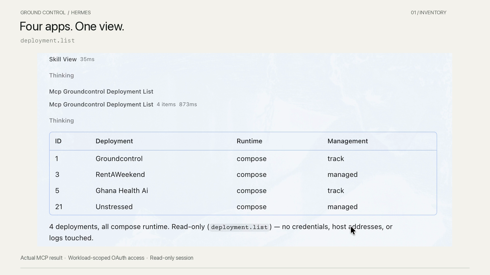

# GroundControl for Hermes

**Requires your own GroundControl instance and an enrolled deployment.** This
plugin does not include a hosted GroundControl account or provision infrastructure.
New to GroundControl? Follow the [installation and first-login guide](https://github.com/teckedd-code2save/groundcontrol/blob/main/docs/start-from-your-computer.md)
and the steps below before connecting Hermes.

Check deployment health, inspect running services, and perform approved releases from Hermes. GroundControl connects the agent to the workloads you choose, with runtime-aware operations and durable progress tracking.

[Watch the 81-second demo](https://github.com/teckedd-code2save/hermes-groundcontrol/releases/download/v0.2.0/GroundControl-Hermes-Product-Demo.mp4): a real Hermes Desktop conversation lists four deployments, compares runtime and endpoint health, investigates deployment history, and checks configuration without exposing values. Eight actual MCP calls use five tool types. The demonstration is read-only; supported write operations are explained, not executed.

## What this package adds

- A native `/groundcontrol` command with setup guidance, the eleven-tool capability catalog and a local JSON evidence receipt.
- A namespaced `groundcontrol:operate` skill covering capability discovery, exact approvals, idempotency, reconnecting to durable operations and honest public verification.
- A read-only MCP configuration example and an optional full-capability profile. Hermes owns OAuth and transport; GroundControl owns resource grants and execution.

This package does not automatically connect, modify configuration, enable write tools, create grants, install itself, or change your deployments. Hermes handles the connection; GroundControl enforces workload access and executes supported operations.

## Setup

### 1. Get GroundControl and add a deployment

Already have an instance? Sign in and confirm that the deployment you want Hermes
to inspect is enrolled, then continue to step 2.

Otherwise, use the [GroundControl setup guide](https://github.com/teckedd-code2save/groundcontrol/blob/main/docs/start-from-your-computer.md)
to choose where it runs:

- **Your computer:** Docker Desktop/Engine must be running Linux containers.
  Windows uses WSL; Apple Silicon uses AMD64 emulation. This mode manages a local
  Docker workspace, not native Mac/Windows services. Local launches use an existing
  image and app port; source builds and multi-service workflows use a Linux server.
- **Your Linux VPS:** use an AMD64 server with SSH access and root or passwordless
  sudo. GroundControl has powerful host access; install only on a host you control.
  The setup guide explains the temporary HTTPS handoff, explicit private mode and required prerequisites.

Open the setup link, claim your instance and choose administrator credentials.
Then [add a project and deployment](https://github.com/teckedd-code2save/groundcontrol/blob/main/docs/projects-and-deployments.md).
Importing a repository alone does not launch an application or enroll a running workload.

A successful browser setup link does not by itself complete Hermes connectivity.
This plugin's documented OAuth configuration uses **your own HTTPS GroundControl
endpoint reachable by Hermes**. The released remote installer offers temporary HTTPS by default; it is a setup bridge, not a durable agent endpoint. Before the rehearsal, verify a supported HTTPS domain or tunnel and the full native OAuth/MCP connection. Do not simply expose the
raw management port. Temporary tunnel URLs are not permanent instance identities.
Local browser access needs no domain, but this guide does not claim a tested
localhost-only Hermes OAuth setup. See the [installation and publishing contract](https://github.com/teckedd-code2save/groundcontrol/blob/main/docs/agent-assisted-installation.md).

### 2. Install the Hermes plugin

Requires Hermes 0.17.0 or later for the native command/skill APIs. The source is published at https://github.com/teckedd-code2save/hermes-groundcontrol. Version 0.2.0 is accepted into the [Hermes catalog](https://github.com/NousResearch/hermes-agent/blob/main/plugin-catalog/groundcontrol.yaml), pinned to `d2905e9cdd710aaa20217e1c24a8091cdf8b9dcc`. Run `hermes plugins install groundcontrol` for that reviewed version. Repository main can be newer than the catalog pin; review its exact revision before installing through `hermes plugins install https://github.com/teckedd-code2save/hermes-groundcontrol --no-enable`, then explicitly enable `groundcontrol` using the installed version's plugin controls. Do not substitute an unreviewed repository URL.

### 3. Connect and verify

Merge `examples/read-only.yaml` into the selected Hermes profile only after replacing its URL with your own HTTPS GroundControl endpoint. Preserve other settings. Complete native Hermes OAuth consent for only the intended workloads and read scopes. Verify an actual `deployment.list` call: anonymous discovery and tool registration do not prove authentication. Never put a bearer token in YAML or paste one into chat.

If the authorized list is empty, check deployment enrollment and the workloads
selected in your grant. Do not expand access automatically. Start with a read-only
request such as: "Load groundcontrol:operate and check the health of my named
deployment. Explain what is verified and what remains unknown."

Use `/groundcontrol setup` and `/groundcontrol capabilities`, then ask Hermes to load `groundcontrol:operate` and inspect the named deployment. The capabilities command shows the catalog; it does not query live access. MCP names may be normalized by Hermes; use discovered tools, not invented names.

The six exposed tools are deployment.list, deployment.inspect, deployment.health, deployment.logs, deployment.config.check and operation.get. GroundControl grants enforce actual access. Tool filtering is not a security sandbox for other Hermes tools.

## Deployment rehearsal

The current eleven-tool contract operates **already-enrolled deployments**. It does not create projects, enroll a new workload or configure its source/secret values. A repository-to-release demonstration must disclose that operator setup, not imply Hermes performed it. Use the [live rehearsal checklist](docs/LIVE-REHEARSAL.md) before recording. The existing catalog demo proves reads only; write approval and deployment still need live acceptance.

## Evidence receipts

`/groundcontrol receipt <JSON>` accepts an object returned by deployment.health or operation.get and emits only a bounded, conservative summary. It does not fetch anything, prove authenticity, or certify a customer journey. Missing public evidence remains unknown. An uncertain operation never recommends replay. An HTTP 2xx is endpoint evidence, not proof of login or checkout.

## Write-enabled use

The operating skill describes the complete workflow, and `examples/full-capability.yaml` adds all five typed write operations to the six read tools:

| Tool | Purpose and effects |
| --- | --- |
| `deployment.source.deploy` | Build and deploy linked source; may change application state and run migrations. |
| `deployment.redeploy` | Recreate from a saved runtime recipe; may interrupt service. |
| `deployment.restart` | Restart existing containers; interrupts the selected workload. |
| `deployment.build_publish` | Build an exact commit and publish registry artifacts; consumes build resources. |
| `deployment.release` | Promote a verified build by digest; changes the running release. |

This optional file is never applied automatically. Enabling mutations requires operator consent to tools and GroundControl scopes plus verified effective Hermes approval controls. Some Hermes builds implement MCP `trust: untrusted`; the installed 0.17.0 build used in the initial acceptance run did not. A version number or ignored config key is not protection. Even supported guards can be bypassed by YOLO, approvals off, or remembered Session/Always grants. Use a fresh session, verify the effective approval state, and choose **Approve Once** for the exact workload/action. GroundControl still checks the selected workload, runtime capability and grant at execution.

Runtime support is discovered per deployment. Compose, generated Compose, standalone images and static sites have different operations and recipe requirements. A source repository does not need to contain Compose. Do not invent a restart for a static site or a recreate recipe for an existing container.

Every accepted write returns a durable operation ID. Keep one idempotency key for identical work and resume by operation ID after disconnects. Report `pending`, `running`, `verifying`, `failed` and `uncertain` honestly; do not replay uncertain work.

## Connection recovery

A rejected refresh token (`invalid_grant`) requires fresh native OAuth consent. GroundControl must return HTTP 401 for missing/invalid access tokens and HTTP 403 for insufficient scope while preserving `_meta["mcp/www_authenticate"]` for tool-level clients. An HTTP 200 tool error can leave native OAuth clients unable to initiate consent. The transport fix is covered by server tests and isolated tests of the installed Hermes OAuth client; verify that the server actually runs it before treating the connection as repaired.

Keep `oauth.redirect_port` stable after client registration. Hermes may otherwise choose a new loopback port while GroundControl expects the registered redirect URI. For an existing client, use its registered port; do not replace a working client or clear credentials just to match an example. Both example profiles now declare their intended OAuth scopes explicitly.

If Desktop's MCP reload times out and tools disappear, stop repeated calls, restore the client connection, and verify one fresh authorized read. Do not clear token files blindly or substitute stale health results. A successful handshake is not a successful authenticated tool call.

## Safety and disclosure

The installed Python plugin reads only its own bundled skill and receives slash-command text. It makes no network calls, runs no shell, starts no background tasks, stores no state or credentials, has no telemetry, and imports no Hermes private modules. Native Hermes MCP separately connects to the configured GroundControl URL and manages its own OAuth tokens. Its tool responses can include infrastructure evidence; do not paste raw secrets or sensitive logs into receipts. A plugin is not a sandbox and has Hermes' process authority.

## Validation

Run `python -m unittest discover -s tests -v`. For current catalog admission run `hermes plugins validate /path/to/hermes-groundcontrol --install-deps` against a reviewed current Hermes checkout. There are no plugin Python dependencies beyond the standard library. See `validation/` for recorded results and `submission/DEMO.md` for the demo plan. No live mutation is part of the current acceptance run.

## GroundControl runtime

The initial runtime acceptance used server `25202bc11fc09b41c6d8a88c5b22721ca0e9a38c`. It supports runtime-aware capability discovery, scoped operations, durable idempotent mutations and honest health uncertainty. The OAuth transport repair `e57f9bd` was deployed on 11 November 2026 with a consistent backup and rollback supervision. The approved demo then used a read-only grant to four selected deployments and fresh native Hermes list, health, inspect, deployment logs and configuration checks. Runtime support varies by deployment and recorded recipe; inspect capabilities before proposing an operation.

MIT. GroundControl source: https://github.com/teckedd-code2save/groundcontrol

### Candidate-only first-deploy testing

The default remains six read-only tools. The released catalog pin is not changed by this branch.
`/groundcontrol experimental` describes the staged, opt-in candidate flow; it performs no actions.
Use [experimental proposal](examples/experimental-proposal.yaml) first, then only after owner acceptance
and separate resource consent use [experimental first launch](examples/experimental-first-launch.yaml).
See [limits and rehearsal steps](docs/EXPERIMENTAL-FIRST-DEPLOY.md). Live discovery and effective
native approvals are required; local tests are not proof of a live deployment.
